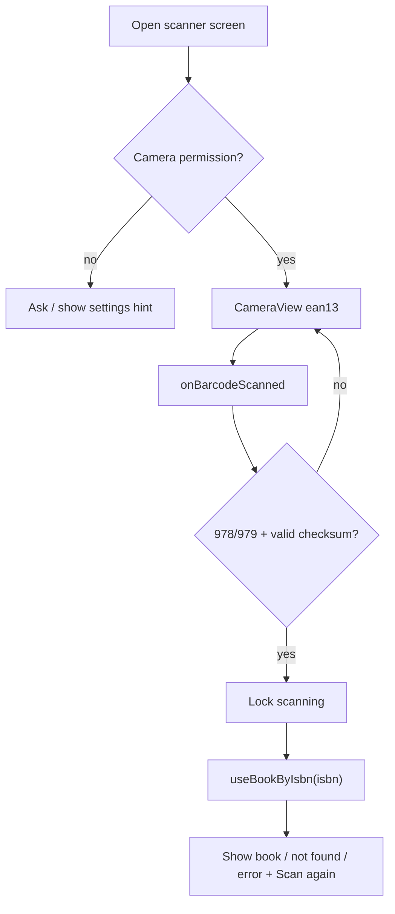

## Goal Description
Scan a book's barcode with the phone camera, extract the ISBN, and look it up on Open Library. This builds on the earlier [isbn_requests_plan.md](isbn_requests_plan.md) (`fetchBookByIsbn` and `useBookByIsbn` with TanStack Query). **This is suggestions only. Nothing will be implemented.**

## Key facts
- **Library:** use `expo-camera` (`CameraView`, `useCameraPermissions`, `onBarcodeScanned`). It's the Expo-recommended module, and it's included in Expo Go. Install it with `npx expo install expo-camera`.
- **The barcode already is the ISBN.** A book's barcode is an **EAN-13** that starts with `978` or `979` ("Bookland"). The 13 digits it decodes to are the ISBN-13, so no conversion is needed. Only scan `ean13`.
- **Ignore other barcodes.** Non-book EAN-13 codes (groceries, for example) don't start with 978/979 and should be ignored. The small second barcode next to the main one is a price add-on (EAN-5), which you can ignore.
- **Validate the checksum.** The ISBN-13 check digit catches bad reads before any network call.
- **Behavior to design for:** `onBarcodeScanned` fires many times per second, so you must lock it after the first valid read.
- **Docs:** I'll verify the exact prop names against the SDK 58 docs (`https://docs.expo.dev/versions/v58.0.0/sdk/camera/`) before implementing. My search results were not version-specific.



## Open Questions
> [!IMPORTANT]
> 1. **Navigation:** should the scanner be a tab, a full-screen modal opened from Home, or a button that pushes a `scan` route? I suggest a modal route (`src/app/scan.tsx`). This is also where the earlier `settings` link problem matters: a route outside the tabs needs to be registered properly.
> 2. After a scan, should the result show on the same screen (a bottom card) or go to a details screen (`book/[isbn]`)?
> 3. Do you want manual ISBN entry as a fallback for damaged barcodes and for the web?
> 4. Is web a target? Camera access on web needs HTTPS, and scanning there is less reliable.

## Proposed Changes

### Dependency and permissions
- Run `npx expo install expo-camera`.
- Add the config plugin to `app.json`. This is needed for the iOS permission text and the Android permission.
```json
["expo-camera", { "cameraPermission": "Allow $(PRODUCT_NAME) to scan book barcodes" }]
```
- The project has no `ios/` or `android/` folders, so permissions come from `app.json`, never from hand edits.

---

### ISBN utility (pure, easy to unit test)
#### [NEW] src/services/isbn.ts
```ts
export function isIsbn13(code: string): boolean {
  if (!/^97[89]\d{10}$/.test(code)) return false;
  const sum = [...code].slice(0, 12)
    .reduce((s, d, i) => s + Number(d) * (i % 2 ? 3 : 1), 0);
  return (10 - (sum % 10)) % 10 === Number(code[12]);
}
```

---

### Scanner screen
#### [NEW] src/app/scan.tsx
```tsx
import { CameraView, useCameraPermissions } from "expo-camera";
import { useRef, useState } from "react";
import { isIsbn13 } from "@/services/isbn";
import { useBookByIsbn } from "@/hooks/use-book-by-isbn";

export default function Scan() {
  const [permission, requestPermission] = useCameraPermissions();
  const [isbn, setIsbn] = useState<string | null>(null);
  const locked = useRef(false); // ref, so it blocks duplicate events immediately

  const { data: book, isFetching, isError } = useBookByIsbn(isbn ?? "");

  if (!permission) return null;
  if (!permission.granted) {
    /* explanation text + <Button onPress={requestPermission} /> */
  }

  const onScan = ({ data }: { data: string }) => {
    if (locked.current || !isIsbn13(data)) return;
    locked.current = true;
    setIsbn(data);
  };

  const reset = () => { locked.current = false; setIsbn(null); };

  return (
    <>
      <CameraView
        style={{ flex: 1 }}
        facing="back"
        barcodeScannerSettings={{ barcodeTypes: ["ean13"] }}
        onBarcodeScanned={isbn ? undefined : onScan}
      />
      {/* overlay frame; when isbn is set show a result card using
          isFetching / isError / book, plus a "Scan again" button calling reset */}
    </>
  );
}
```

---

### Navigation
#### [MODIFY] src/app/_layout.tsx and src/components/app-tabs.tsx (and `app-tabs.web.tsx`)
Depending on your answer to question 1, either add a `scan` trigger to the tabs, or restructure to a `Stack` with a `(tabs)` group and a modal `scan` route.

---

### Possible extras (later)
- Haptic feedback on a successful scan (`expo-haptics`).
- A torch toggle (`enableTorch` on `CameraView`).
- Saving scanned books to local storage (`expo-sqlite`).

## Verification Plan
### Automated Tests
- `npx tsc --noEmit` and `npx expo lint`.
- Unit-test `isIsbn13` with a known valid code (`9780140328721`), a bad checksum, and a non-978/979 EAN.

### Manual Verification
The camera needs a **real device**, using Expo Go or a development build.
- Scan a book barcode. The title and cover should appear.
- Scan a grocery barcode. Nothing should happen.
- Deny the permission. The explanation screen should appear.
- Pointing at the barcode for several seconds must trigger only one request.
- "Scan again" should reset the screen.
