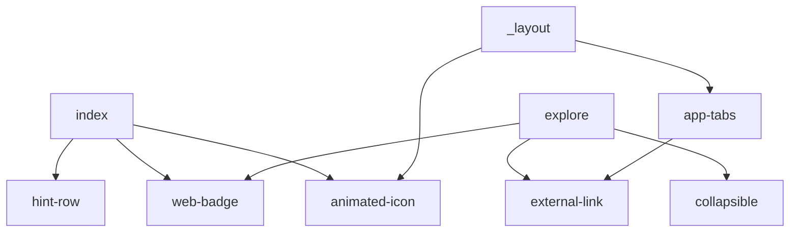

## Goal Description
**Short answer:** yes. Most people delete the starter template's demo content right away. The usual order is:
1. Delete the demo screens and anything only they used.
2. Keep the small foundation pieces (theme, themed components, color-scheme hooks) if you'll build UI with them. Many people also replace those later.
3. Remove unused dependencies and assets last.
4. Commit before and after, so you can recover anything. Git history is your safety net.

Expo's own `npm run reset-project` script (already in `package.json`) does a version of step 1. It moves or deletes the example code and leaves a blank `app/` folder. I'd rather prune by hand, because our Home screen and layout are already customised.

> [!NOTE]
> **Nothing has been deleted.** This is the proposed list. It also covers the cleanup that Phase 1 of [navigation_simplify_plan.md](navigation_simplify_plan.md) said I'd ask you about.

## How I decided what to cut
I read every import in `src/`. A file is only safe to delete if nothing that stays imports it.

## Proposed Changes

### Delete: unused once we apply the Phase 1 navigation plan
| File | Why |
|---|---|
| `src/app/explore.tsx`, `src/app/settings.tsx` | Demo screens (you said no other pages) |
| `src/components/app-tabs.tsx`, `app-tabs.web.tsx` | Tabs are being removed |
| `src/components/ui/collapsible.tsx` | Only `explore` used it |
| `src/components/external-link.tsx` | Only `explore` and the web tabs used it |
| `src/components/hint-row.tsx` | Only the starter Home content used it |
| `src/components/web-badge.tsx` | Starter Home content, and web is ignored |
| `assets/images/tabIcons/*` | Tab icons |
| `assets/images/tutorial-web.png`, `react-logo*.png`, `expo-badge*.png`, `logo-glow.png`, `expo-logo.png` | Starter artwork. I'll check each is unreferenced (`animated-icon` may use some) before deleting |
| `scripts/reset-project.js` and the `reset-project` script in `package.json` | Not needed after cleanup |

### Keep: you'll probably use these
| File | Why |
|---|---|
| `src/components/themed-text.tsx`, `themed-view.tsx` | Light and dark themed building blocks |
| `src/constants/theme.ts`, `src/hooks/use-theme.ts`, `use-color-scheme.ts` | Theme foundation |
| `src/app/_layout.tsx`, `src/app/index.tsx` | Rewritten per the navigation plan |
| `assets/images/icon.png`, `splash-icon.png`, `favicon.png`, android icons, `assets/expo.icon` | Referenced by `app.json`. Replace them with your own branding later |

### Decide
> [!IMPORTANT]
> - **Animated splash and icon** (`animated-icon.tsx`, `.web.tsx`, `.module.css`, plus `react-native-reanimated` and `react-native-worklets` which it uses): it's an Expo-branded animation. I'd **delete** it and use the plain native splash from `app.json`. It's simpler, but it's your choice.
> - **`.web` files** (`use-color-scheme.web.ts` and `animated-icon.web.tsx`): web is ignored. They're harmless, so I'd leave them for now.
> - **`app.json` `web.output: "server"`:** harmless for now, and web is ignored.

### Dependencies to review (only after the deletions)
Likely removable: `expo-web-browser` and `expo-linking` (after `external-link` is gone). Also `expo-symbols`, `expo-device`, `expo-glass-effect` and `@expo/ui`, if nothing imports them. I'd run `npx expo-doctor` and grep for each one before removing it. Keep `expo-router`, `expo-image` (book covers), `expo-splash-screen`, `expo-status-bar`, `react-native-safe-area-context` and `react-native-screens`. `react-native-gesture-handler` and `react-native-reanimated` can stay too: they're standard and cheap, and Router can use them.

## Verification Plan
### Automated Tests
- Before each deletion batch, I'll grep that nothing remaining imports the file.
- After deleting, run `npx tsc --noEmit`, `npx expo lint` and `npx expo-doctor`.

### Manual Verification
- Run `npx expo start`. The app should open on Home with a "Scan book" button, with no red-screen errors.
- Confirm the app icon and splash screen still render.
- Commit the cleanup as its own commit so it's easy to revert.
