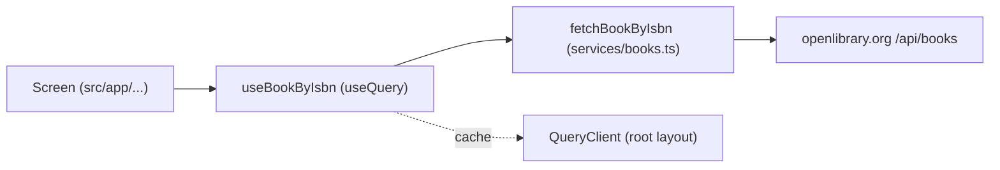

## Goal Description
Add ISBN lookups to `library-mobile` (Expo SDK 58, Expo Router) using **Open Library** and **TanStack Query** on top of the built-in `fetch`. **Nothing is implemented until you approve.**

TanStack Query works in React Native. It is plain JavaScript on top of React, so it needs no native code and no development build. It runs on iOS, Android and web.



## Open Questions
> [!NOTE]
> 1. Is a demo on `explore.tsx` fine, or do you want a dedicated screen such as `book/[isbn].tsx`?
> 2. Barcode scanning is out of scope for now.

## Proposed Changes

### Dependency
Run `npx expo install @tanstack/react-query`. The project has no `bun.lock`, so I'll use `npx`. This is the only package that gets added.

---

### Service layer
#### [NEW] src/services/books.ts
```ts
export type Book = {
  isbn: string;
  title: string;
  authors: string[];
  coverUrl?: string;
};

const BASE_URL = "https://openlibrary.org";

export const normalizeIsbn = (raw: string) => raw.replace(/[\s-]/g, "");
export const isValidIsbn = (isbn: string) => /^(\d{9}[\dXx]|\d{13})$/.test(isbn);

export async function fetchBookByIsbn(
  rawIsbn: string,
  signal?: AbortSignal,
): Promise<Book | null> {
  const isbn = normalizeIsbn(rawIsbn);
  if (!isValidIsbn(isbn)) throw new Error("Invalid ISBN");

  const key = `ISBN:${isbn}`;
  const res = await fetch(
    `${BASE_URL}/api/books?bibkeys=${key}&jscmd=data&format=json`,
    { signal },
  );
  if (!res.ok) throw new Error(`Request failed (${res.status})`);

  const data = (await res.json())[key];
  if (!data) return null; // not found -> API returns {}

  return {
    isbn,
    title: data.title,
    authors: (data.authors ?? []).map((a: { name: string }) => a.name),
    coverUrl: data.cover?.medium,
  };
}
```

---

### Query provider
#### [MODIFY] src/app/_layout.tsx
Create one `QueryClient` outside the component and wrap the existing tree:
```tsx
import { QueryClient, QueryClientProvider } from "@tanstack/react-query";

const queryClient = new QueryClient({
  defaultOptions: { queries: { staleTime: 1000 * 60 * 60, retry: 1 } },
});

// inside TabLayout's return:
<QueryClientProvider client={queryClient}>
  <ThemeProvider ...>...</ThemeProvider>
</QueryClientProvider>
```
A book's metadata rarely changes, so a long `staleTime` avoids repeat network calls.

---

### Hook
#### [NEW] src/hooks/use-book-by-isbn.ts
```ts
import { useQuery } from "@tanstack/react-query";
import { fetchBookByIsbn, isValidIsbn, normalizeIsbn } from "@/services/books";

export function useBookByIsbn(isbn: string) {
  const clean = normalizeIsbn(isbn);
  return useQuery({
    queryKey: ["book", clean],
    queryFn: ({ signal }) => fetchBookByIsbn(clean, signal), // auto-cancel
    enabled: isValidIsbn(clean), // don't fetch while the user is still typing
  });
}
```
The hook returns `data`, `isPending`, `isError`, `error` and `refetch`, so no manual loading or error `useState` is needed.

---

### Example usage
#### [MODIFY] src/app/explore.tsx (demo)
```tsx
const [isbn, setIsbn] = useState("9780140328721");
const { data: book, isFetching, isError, error } = useBookByIsbn(isbn);

<TextInput value={isbn} onChangeText={setIsbn} keyboardType="number-pad" />
{isFetching && <ActivityIndicator />}
{isError && <Text>{error.message}</Text>}
{book === null && <Text>No book found</Text>}
{book && (
  <>
    <Text>{book.title}</Text>
    <Text>{book.authors.join(", ")}</Text>
    {book.coverUrl && <Image source={book.coverUrl} style={{ width: 120, height: 180 }} />}
  </>
)}
```
`Image` comes from `expo-image`, which is already installed.

## Verification Plan
### Automated Tests
- `npx tsc --noEmit`
- `npx expo lint`

### Manual Verification
- Run `npx expo start`. ISBN `9780140328721` should show "Fantastic Mr Fox" and its cover.
- An incomplete ISBN should not trigger a request.
- Looking up the same ISBN twice should be instant the second time (cache).
- A valid but unknown ISBN should show "No book found".
- With the network off, an error should show and the app must not crash.
